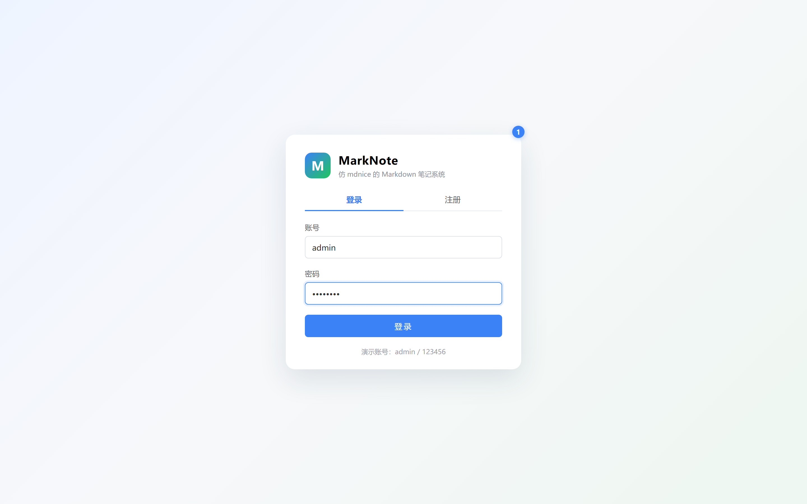
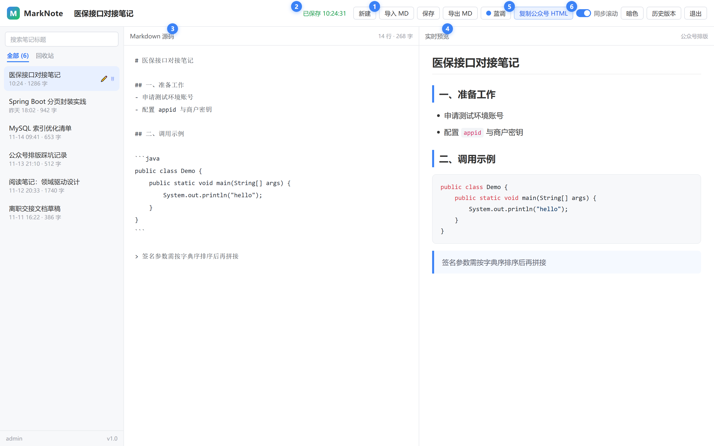
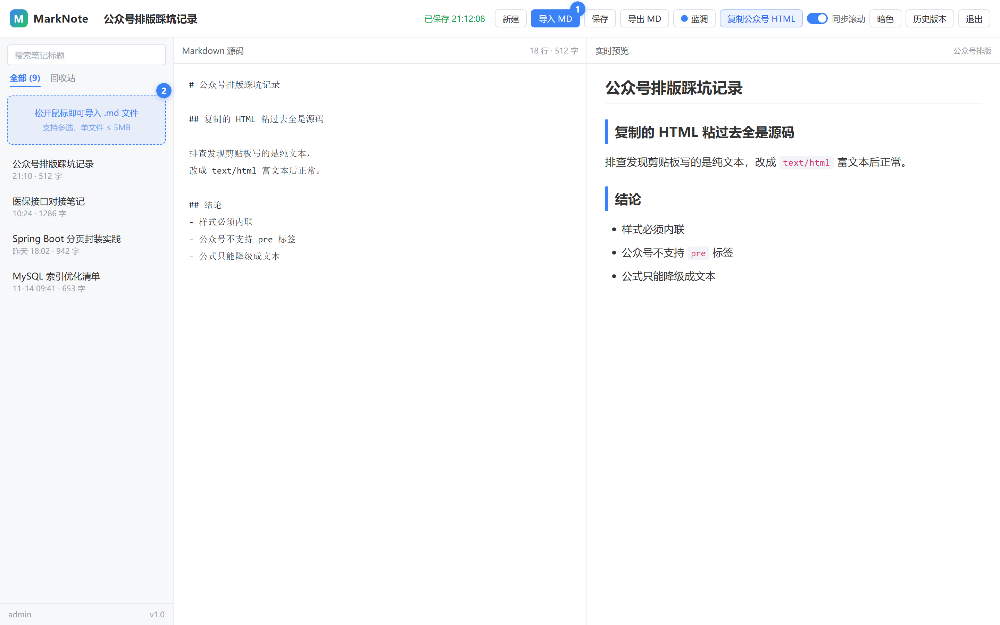
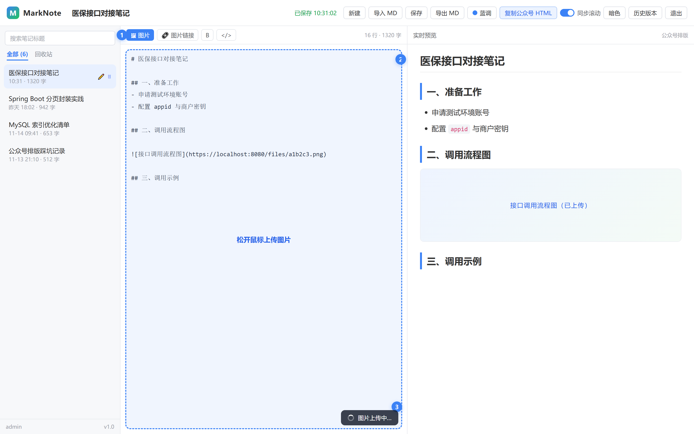
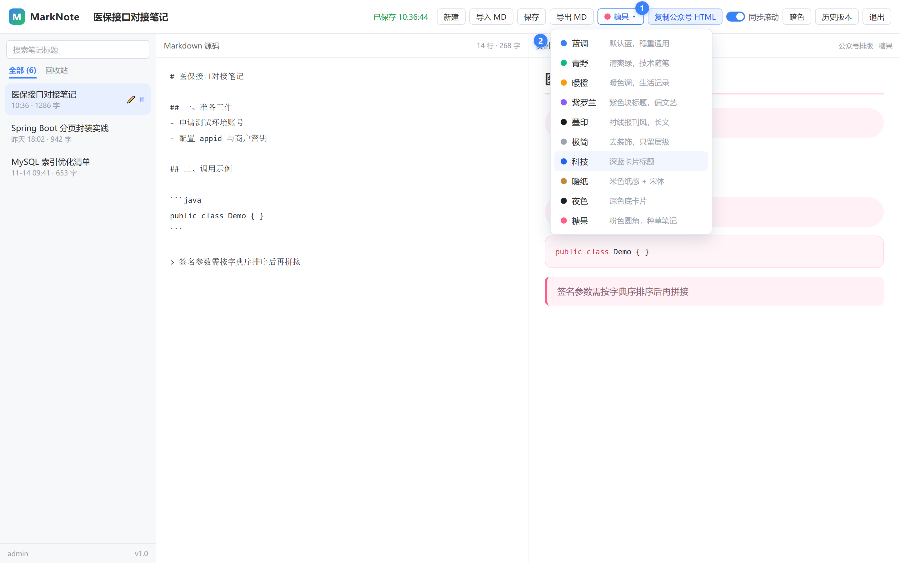
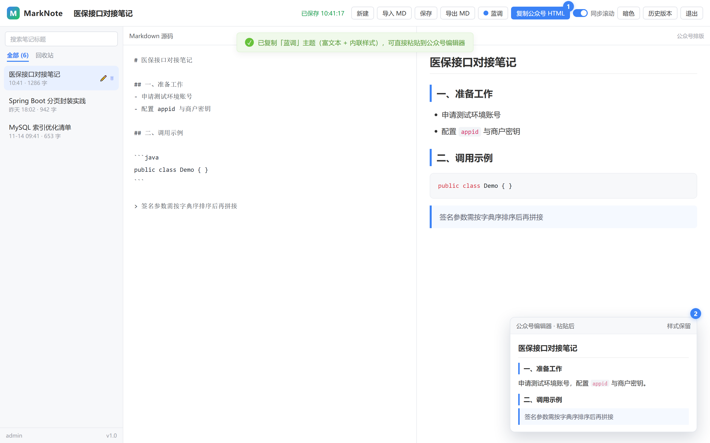

# MarkNote 功能介绍与操作指南

> 一个仿 mdnice 的 Markdown 笔记系统：左边写 Markdown，右边实时出公众号排版，写完整篇一键复制，粘到公众号后台不掉格式。
>
> 版本：v1.0 ｜ 部署形态：Windows 本地（前后端分离） ｜ 文档日期：2026-11-16

---

## 一、这套系统解决什么问题

日常写技术笔记、公众号文章，常见三个痛点：

| 痛点 | 传统做法 | MarkNote 的做法 |
| --- | --- | --- |
| 写作和排版分离 | Typora 写完，再复制到公众号后台手动调样式 | 左写右预览，预览就是公众号最终效果 |
| 粘贴后排版丢失 | 复制 HTML 源码或纯文本，粘过去全掉格式 | 复制的是**富文本 + 全内联样式**，直接粘即可 |
| 样式改一处要改全篇 | 每个标题单独调字号、颜色、边框 | 10 套排版主题一键切换，全篇同步 |

系统本身还是个正经的笔记库：多笔记管理、自动保存、历史版本、回收站、图片托管，不只是一个「排版工具」。

---

## 二、技术栈

| 层 | 技术 |
| --- | --- |
| 前端 | Vue 3 + Vite 5 + Element Plus + markdown-it + highlight.js + KaTeX |
| 后端 | Spring Boot 3.2（JDK 17）+ MyBatis-Plus 3.5.5 |
| 数据库 | MySQL 8（`marknote` 库，4 张表：user / note / note_history / image） |
| 对象存储 | MinIO（图片上传；**MinIO 不可用时自动落本地磁盘**并经 `/files/**` 提供访问） |
| 鉴权 | JWT（登录后所有接口带 `Authorization` 头） |

---

## 三、功能总览

| 模块 | 能力 |
| --- | --- |
| 账号 | 登录、注册（新用户走 bcrypt），JWT 校验，401 自动跳登录页 |
| 笔记管理 | 新建、改标题、标题搜索、移入回收站、恢复、彻底删除 |
| 写作 | 左右分栏实时预览、同步滚动开关、代码高亮、数学公式、字数与行数统计 |
| 自动保存 | 内容停笔 1.2 秒落库；标题改完 0.9 秒落库；回车立即保存 |
| 导入 | 顶栏「导入 MD」多选文件；也可把 `.md/.markdown/.txt` 直接拖进左侧列表 |
| 图片 | 本地选图上传、拖拽上传、粘贴截图上传、插入外链图床地址；单张 ≤ 10MB |
| 排版 | 10 套公众号主题，切换后预览与复制同步生效 |
| 输出 | 一键复制公众号富文本；导出 `.md` 文件 |
| 历史版本 | 每次保存自动写快照（`note_history`），可查看并回滚 |
| 外观 | 编辑器暗色 / 浅色切换（与文章主题互不影响） |

---

## 四、启动步骤

### 1. 起依赖

```bash
cd marknote
docker compose up -d
```

- MySQL：`localhost:3306`（`marknote` 库，首次启动自动执行 `sql/init.sql`）
- MinIO：API `9000`，控制台 `9001`（minioadmin / minioadmin）

### 2. 起后端

要求 **JDK 17 + Maven 3.8+**。

```bash
cd marknote-server
mvn spring-boot:run
```

或直接双击根目录 `start-backend.bat`。启动前按需改 `application.yml` 里的数据源与 MinIO 配置。

### 3. 起前端

```bash
cd marknote-web
npm install
npm run dev
```

或双击 `start-frontend.bat`。浏览器打开 **http://localhost:3000**。

> 演示账号：**admin / 123456**（`sql/init.sql` 已预置，可直接登录）

---

## 五、推荐操作流程（图文）

下面按「第一次用 → 写完一篇 → 发到公众号」的完整链路走一遍。

### 步骤 1：登录



打开 http://localhost:3000，用演示账号 `admin / 123456` 登录；没有账号可以切到「注册」页，填账号、密码、昵称即可直接进系统。

**①** 登录卡片：账号、密码两栏，回车也能提交。注册的新用户走 bcrypt 加密，演示账号兼容明文密码。

---

### 步骤 2：新建笔记 + 改标题



进入主界面后，整体分三块：**左栏笔记列表 / 中间 Markdown 源码 / 右侧公众号预览**。

**①** 顶栏「新建」：点一下创建一篇空笔记，内容预置 `# 无标题笔记`，光标会自动跳到标题框并全选。

**②** 标题框：直接改标题，输入即自动保存（0.9 秒防抖），回车立即落库。三个改标题入口：

- 顶栏标题框直接输入
- 左侧列表悬停出现「✏️」，点开弹框重命名
- 左侧列表标题**双击**，同样弹出重命名框

> 小细节：当正文第一行正好是 `# 旧标题`（自动生成的占位标题）时，改名会同步替换正文首行，不会出现「标题叫 A、正文第一行还是无标题笔记」。

---

### 步骤 3：写作与实时预览


**③** Markdown 源码区：标准 Markdown 语法，支持标题、列表、表格、引用、代码块、行内代码、KaTeX 公式。

**④** 实时预览区：所见即公众号最终效果。代码块带 highlight.js 高亮，表格、引用、列表样式齐全。

顶栏 **「同步滚动」** 开关打开时，左边滚到哪右边跟到哪；写长文建议开着。

停笔 1.2 秒自动保存，顶栏状态会显示「已保存 10:24:31」，不用手动点保存。

---

### 步骤 4：导入已有的 Markdown 文件



**①** 顶栏「导入 MD」：支持多选 `.md` / `.markdown` / `.txt`，单文件上限 5MB，非文本文件自动跳过。

**②** 拖拽导入：把文件直接拖进左侧笔记列表，出现蓝色虚线框和「松开鼠标即可导入 .md 文件」提示，松手即导入。

导入规则：

- 标题取正文第一个 `# 一级标题`，没有则用文件名（去扩展名，截断 80 字）
- 多文件按选择顺序依次入库，导入完自动选中最后一篇
- 当前在「回收站」标签下导入时，会自动切回「全部」

---

### 步骤 5：插入图片



三种方式，任选：

**①** 编辑区工具栏「🖼 图片」：选本地图片，可一次多张，上传完按光标位置逐张插入 ``。

**②** 把图片文件拖进编辑区：出现蓝色虚线遮罩「松开鼠标上传图片」，松手即传。

**③** 上传中右下角显示「图片上传中…」；多图按顺序插入，不会串位。

另外两种补充方式：

- **粘贴截图**：Ctrl+V 直接粘贴剪贴板里的截图，自动上传并插入
- **🔗 图片链接**：弹框输入任意图床地址（http/https），校验后插入

上传约束：支持 png / jpg / jpeg / gif / webp / bmp / svg，单张 ≤ 10MB；优先存 MinIO，MinIO 连不上时自动落本地 `uploads/`，功能不中断。

---

### 步骤 6：选一套公众号排版主题



**①** 顶栏主题下拉（按钮上带一个主题色圆点）：点开列出 10 套主题，每项带色点、名称和风格说明。

**②** 选中后预览区立即换装，复制到公众号时用的就是当前主题的样式。

主题选择会记在浏览器 `localStorage`，下次打开还是这套；换电脑需要重新选一次。

10 套主题一览：

| 主题 | 主色 | 适合内容 |
| --- | --- | --- |
| 蓝调（默认） | `#3b82f6` | 通用技术笔记、教程 |
| 青野 | `#10b981` | 清爽技术随笔、踩坑记录 |
| 暖橙 | `#f59e0b` | 生活记录、经验分享 |
| 紫罗兰 | `#8b5cf6` | 偏文艺的随笔、读书笔记 |
| 墨印 | `#1a1a1a` | 衬线报刊风，适合长文、深度稿 |
| 极简 | 灰阶 | 只想要干净文字层级时 |
| 科技 | `#2563eb` | 接口文档、架构说明 |
| 暖纸 | `#c08a3e` | 米色纸感 + 宋体，散文、复盘 |
| 夜色 | 深色底 | 评测、极客向、对比类 |
| 糖果 | `#ff5c8a` | 种草、轻量分享 |

---

### 步骤 7：复制到公众号



**①** 点顶栏「复制公众号 HTML」，提示「已复制「蓝调」主题（富文本 + 内联样式）」。

**②** 打开公众号后台编辑器，Ctrl+V 直接粘贴。标题边框、引用底色、代码高亮颜色、表格边框都会保留。

实现要点（排障时有用）：

- 剪贴板写入的是 `text/html` **富文本**（不是 HTML 字符串文本），这才是粘过去有排版的前提
- 复制前会把预览区每个元素的 `getComputedStyle` 结果内联成 `style` 属性，并去掉 class —— 公众号会过滤 class，但认内联样式
- 公众号不支持 `<pre>`，代码块会被转成带背景的 `<section>`，换行改成 `<br>`，高亮 token 颜色保留
- 公众号不支持 KaTeX：公式会降级成 TeX 源码文本，并弹提示建议改用截图

> 前提：必须用 `localhost` 或 `https` 访问。用 `http://192.168.x.x` 打开时浏览器禁用剪贴板 API，会退化为 `execCommand` 兜底复制。

---

### 步骤 8：保存、历史版本、回收站

- **保存**：正常不需要点，自动保存已在跑。切笔记、切标签、导入前都会先 flush 一次未保存内容。
- **历史版本**：顶栏「历史版本」→ 左侧列出快照时间，右侧预览内容，选中后点「恢复到该版本」。每次保存（含改标题）都会写一条快照。
- **回收站**：列表项悬停「🗑」移入回收站；「回收站」标签下可「恢复」或「彻底删除」（彻底删除不可恢复）。
- **导出**：顶栏「导出 MD」把当前笔记下载成 `.md`，文件名取自标题。

---

## 六、常见问题

**1. 登录后接口 401**
token 过期（默认 24 小时）或请求没带 `Authorization` 头，重新登录即可。

**2. 图片显示不出来**
先看图片 URL 是 MinIO 还是本地 `/files/`：

- MinIO 地址：确认桶 `marknote` 已创建且公开读（首次上传会自动处理）；MinIO 不在本机时把 `minio.public-endpoint` 改成外网可访问地址
- 本地 `/files/`：确认后端 `app.file-base-url` 与浏览器实际访问的后端地址一致（默认 `http://localhost:8080`）

**3. 复制到公众号还是没排版**
检查是不是用 `http://` 的局域网 IP 打开的页面（剪贴板 API 被禁用），换成 `localhost` 再试；另外粘贴时用 Ctrl+V，不要用「粘贴为纯文本」。

**4. 公式粘过去变成一串 TeX**
公众号不支持 KaTeX 渲染，这是客观限制。公式建议在预览区截图后作为图片插入，或直接写 TeX 源码让读者自行理解。

**5. 后端启动报数据库连接失败**
`application.yml` 里的数据源要与实际 MySQL 地址一致；Docker 版默认 `localhost:3306`，账号密码见 `docker-compose.yml`。

**6. 改标题后列表没变**
列表刷新跟着保存走（0.9 秒防抖）。如果一直不变，看顶栏状态是不是「保存失败」——多半是后端没起或 token 失效。

---

## 七、几个提效小技巧

| 场景 | 操作 |
| --- | --- |
| 批量迁移旧笔记 | 一次多选几十个 `.md`，或整个文件夹拖进列表逐个拖（单文件 ≤ 5MB） |
| 写完想先存草稿再排版 | 先写内容，最后再切主题；主题只影响外观，不动内容 |
| 想对比两套主题 | 切主题只看右栏预览，不用重新排版正文 |
| 长文写作 | 开「同步滚动」，左写右看，避免来回找位置 |
| 快速改标题 | 双击左侧列表标题，比回顶栏更快 |
| 误删找回 | 移入回收站不会真删，去「回收站」标签恢复即可 |

---

## 八、目录结构速查

```
marknote/
├── sql/init.sql              # 建库建表 + 演示账号 + 示例笔记
├── docker-compose.yml        # MySQL 8 + MinIO 一键起
├── start-backend.bat         # 后端启动脚本
├── start-frontend.bat        # 前端启动脚本
├── marknote-server/          # Spring Boot 3 后端（8080）
│   └── src/main/java/com/marknote/
│       ├── controller/       # User / Note / NoteHistory / Image
│       ├── service/          # 业务层（保存时写历史快照）
│       ├── config/           # CORS / JWT 拦截器 / 静态资源映射
│       └── util/             # JWT、统一返回
└── marknote-web/             # Vue3 前端（3000）
    └── src/
        ├── views/            # Login、Editor（主工作台）
        ├── components/       # MarkEditor（编辑器 + 预览 + 图片上传）
        ├── theme/themes.js   # 10 套主题清单
        └── styles/           # editor.css、themes.css
```

---

*配图为按真实界面样式复刻渲染的示意图（同色板、同布局、无任何水印）。*
